# M1 : Modèle relationnel NovaMarket

## Grain des sources

| Source | Une ligne représente | Clé | Relation |
| --- | --- | --- | --- |
| `customers.csv` | un client | `customer_id` | 1 client → N commandes |
| `orders.csv` | une commande | `order_id` | 1 commande → N articles, N paiements |
| `order_items.csv` | une ligne d'article d'une commande | `order_item_id` | N lignes → 1 commande |
| `payments.ndjson` | une opération de paiement | `payment_id` | N paiements → 1 commande |
| `products.csv` | un produit du catalogue | `product_id` | 1 catégorie → N produits ; 1 produit → N lignes d'articles |
| `categories.csv` | une catégorie de produits | `category_id` | 1 catégorie parente → N sous-catégories (`parent_category_id` pointe vers la même table) |

En S1, `products.csv` et `categories.csv` étaient hors périmètre. Ils sont intégrés en S2 (voir
`catalogue.md`) : `order_items.product_id` reçoit alors sa clé étrangère vers `core.products`.

## Schéma

```mermaid
erDiagram
    CUSTOMERS ||--o{ ORDERS : passe
    ORDERS ||--|{ ORDER_ITEMS : contient
    ORDERS ||--o{ PAYMENTS : "est réglée par"
    PRODUCTS ||--o{ ORDER_ITEMS : "est vendu dans"
    CATEGORIES ||--o{ PRODUCTS : classe
    CATEGORIES ||--o{ CATEGORIES : "est parent de"

    CUSTOMERS {
        integer customer_id PK
        text customer_name "NOT NULL"
        text city "NOT NULL"
    }
    ORDERS {
        integer order_id PK
        integer customer_id FK "NOT NULL"
        date ordered_on "NOT NULL"
        text status "completed | pending | cancelled"
    }
    ORDER_ITEMS {
        integer order_item_id PK
        integer order_id FK "NOT NULL"
        integer product_id FK "NOT NULL, clé ajoutée en S2"
        integer quantity "CHECK > 0"
        integer unit_price_cents "CHECK >= 0"
    }
    PAYMENTS {
        integer payment_id PK
        integer order_id FK "NOT NULL"
        date paid_on "NOT NULL"
        integer amount_cents "CHECK > 0"
        text status "captured | pending"
    }
    PRODUCTS {
        integer product_id PK
        text sku "UNIQUE"
        text product_name "NOT NULL"
        integer category_id FK "NOT NULL"
        date first_listed_on "NOT NULL"
    }
    CATEGORIES {
        integer category_id PK
        text category_name "NOT NULL"
        integer parent_category_id FK "vide pour une racine"
    }
```

## Trois couches

| Schéma | Rôle | Contraintes |
| --- | --- | --- |
| `reception` | copie brute des fichiers, colonnes en `text` (paiements : un document `jsonb` par ligne), numéro de ligne `source_row` | aucune : rien n'est perdu au chargement |
| `quality` | `rejected_rows` : fichier, numéro de ligne, clé, cause du rejet | aucune |
| `core` | données métier typées et fiables, utilisées par les indicateurs | clés primaires, clés étrangères, `NOT NULL`, `CHECK` |

Ordre d'intégration imposé par les clés étrangères : `customers`, `orders`, puis `order_items` et
`payments`.

## Choix de conception justifiés

1. **Réception en `text` sans contrainte.** Un `\copy` direct dans une table contrainte échoue à
   la première anomalie (doublon de clé de `order_item_id` 7) et annule tout le fichier. En
   réception, les 802 lignes sont chargées ; chaque ligne est ensuite contrôlée (doublon, statut
   inconnu, référence inexistante) et part soit en `core`, soit en `quality.rejected_rows` avec sa
   cause. Le contrôle `reçues = intégrées + rejetées` le prouve.
2. **Montants en centimes `integer`.** Les sources sont en centimes : un entier évite toute erreur
   d'arrondi des flottants et garde le montant exact. La conversion en euros (`/ 100.0`) n'a lieu
   qu'à l'affichage des indicateurs.
3. **Statuts en `text` avec `CHECK`** plutôt qu'un type `ENUM` : la liste est contrôlée et sensible
   à la casse, comme l'indique le dictionnaire, et reste modifiable sans `ALTER TYPE`.
4. **Doublons départagés par `source_row`.** Pour un même identifiant, la ligne qui apparaît en
   premier dans le fichier (plus petit `source_row`) est gardée ; les suivantes sont rejetées avec la
   cause `doublon`.
5. **Paiements gardés au grain de l'opération.** Une commande peut avoir plusieurs paiements :
   aucune déduplication sur (commande, date, montant), voir `anomalies.md`.
